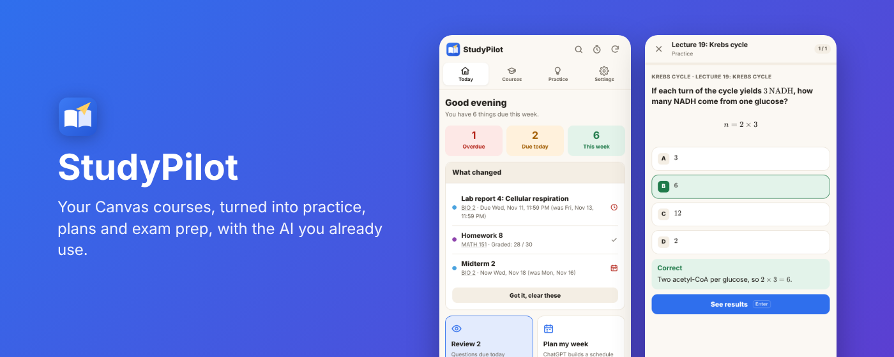

<h1 align="center">StudyPilot</h1>

Your Canvas courses, turned into a study coach. Free Chrome extension that works with the AI you already use.

  <a href="https://chromewebstore.google.com/detail/fimfldjklciihkiipnncdgkbegkkcdim">Chrome Web Store</a> ·
  <a href="https://connorlabianco.github.io/StudyPilot/">Website</a> ·
  <a href="https://connorlabianco.github.io/StudyPilot/privacy.html">Privacy</a> ·
  <a href="https://connorlabianco.github.io/StudyPilot/support.html">Support</a>

## What it does

- **Your week at a glance:** every deadline across your courses, what changed since you last looked, and exam dates found in your syllabus and announcements.
- **Lecture mastery:** your AI reads each lecture once and lists everything to learn, slide by slide; StudyPilot checks nothing was skipped, then you learn it in short parts with questions it grades itself (multiple choice with reasons, matching, ordering, calculations with fresh numbers, step-by-step problems, explain-in-your-own-words). The lecture and slide on every question open the lecture right there.
- **Course quiz:** pick lectures and how much each counts; a mixed quiz from your mastery questions, missed ones first.
- **My week:** class times your AI finds in your syllabi (with your own section), the study time you mark, deadlines and exams on one weekly calendar. Shown on Canvas's own calendar too, downloadable as a calendar file, or kept in Google Calendar.
- **Study plan:** pick what you're studying for; your AI sizes each assignment once from its files and sets priorities; StudyPilot fits the work into your study time and moves anything you miss.
- **One list for your AI:** every request waiting for your AI in one place; you press Send and StudyPilot picks up each answer by itself.
- **JupyterHub notebooks as lectures:** lecture notebooks from each course's hub get the same checklists and questions, with their outputs, plots and data; homework notebooks help size the study plan.
- **Focus timer, search across everything, grade calculator, tidy file downloads,** and learning from graded Gradescope work.

No account, no API key, no server. See the [privacy policy](docs/privacy.html).

## Install

- **Most people:** install from the [Chrome Web Store](https://chromewebstore.google.com/detail/fimfldjklciihkiipnncdgkbegkkcdim).
- **From source:** download this repository, open `chrome://extensions`, turn on Developer mode, click **Load unpacked** and pick the folder. Google sign-in only works in the store version (see [SETUP-GOOGLE.md](SETUP-GOOGLE.md)).

## Project layout

| Folder | What's in it |
| --- | --- |
| `background.js`, `lib/` | The service worker: Canvas, Gradescope and video readers, mastery, schedule and plan logic, search, sync, focus timer |
| `sidepanel/` | The side panel (Today, Courses, Practice, Settings) |
| `week/` | My week, the weekly calendar page |
| `content/` | Small scripts on Canvas pages (themes, to-do lists, video speed, the calendar overlay) |
| `viewer/` | The slide viewer the lecture links open |
| `grades/` | The grade calculator |
| `offscreen/` | PDF reading and zip building |
| `vendor/` | Bundled libraries: [pdf.js](https://github.com/mozilla/pdf.js) and [KaTeX](https://github.com/KaTeX/KaTeX), both with their licenses |
| `docs/` | The website, privacy policy and support page (GitHub Pages) |

Version history is in [CHANGELOG.md](CHANGELOG.md). Google Calendar review steps are in [GOOGLE-CALENDAR-VERIFICATION.md](GOOGLE-CALENDAR-VERIFICATION.md).

StudyPilot is an independent project and isn't affiliated with Instructure, Gradescope, Panopto or any AI provider.
